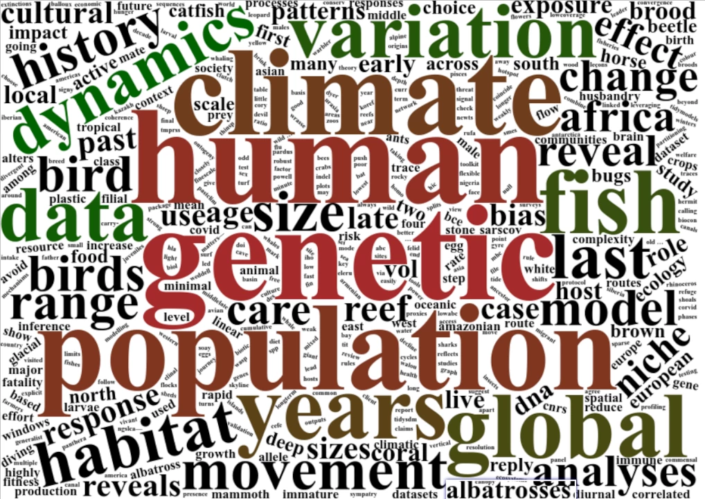

{fig-alt="Word cloud from the titles of our publications"}

This is a list of our papers, with group members in bold; click on the  icon after each paper for a link to the
original publication. If you are interested in the publications authored by a specific group member,
go to their profile on the [People page](./people.html) and follow their Google Scholar link.

----

```{r update_bibArticle}
#| results: hide
#| echo: false

# update the metadata on group members (used to highlight them in bold)
source("./r_scripts/update_people_metadata.R")
people_metadata <- read.csv("papers/people_metadata.csv")

# update the publication list from ORCID
source("./r_scripts/update_bib_from_orcid.R")
source("./r_scripts/bib_publication_list.R")
bib_path <- "papers/andrea_manica_pubs.bib"
# if the update fails (e.g. no internet connection), use the bib as it is
tryCatch(
  update_bib_from_orcid(bib_path, "0000-0003-1895-450X",
                        author_family = "Manica",
                        backup_dir = "papers/orcid_sync",
                        log_dir = "papers/orcid_sync"),
  error = function(e) warning("Could not update ", bib_path, " from ORCID: ",
                              conditionMessage(e))
)
group_pubs <- read_bib_publications(bib_path)
```

```{r bibArticle}
#| results: asis
#| echo: false

format_bib_publication_list(group_pubs, people_metadata) |> cat(sep='\n\n')
```

